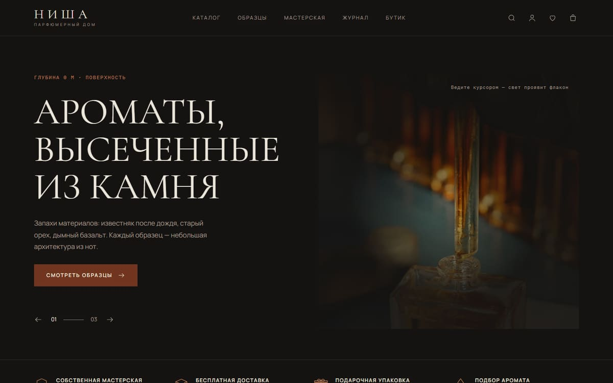
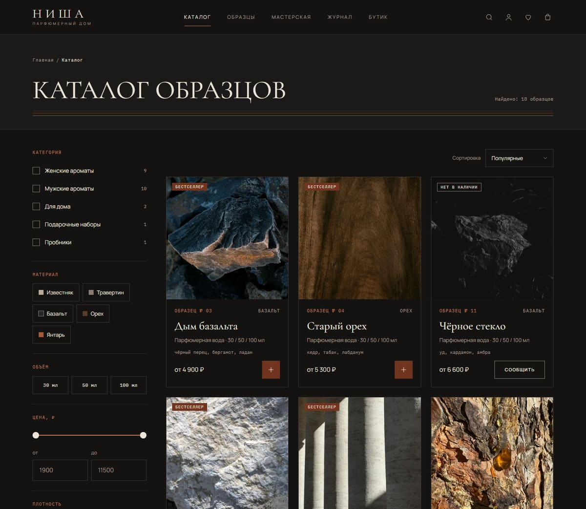
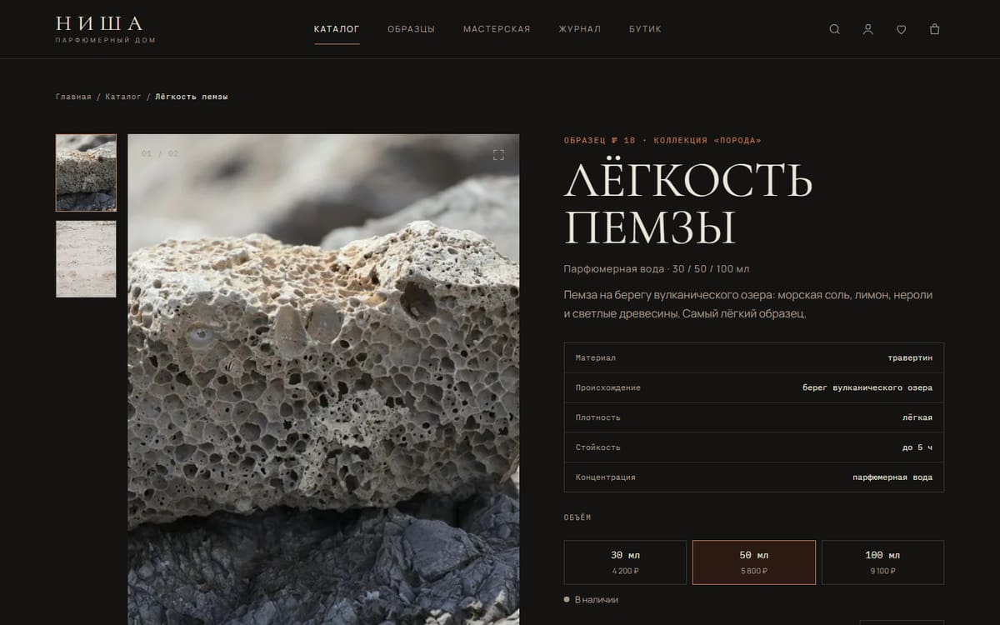
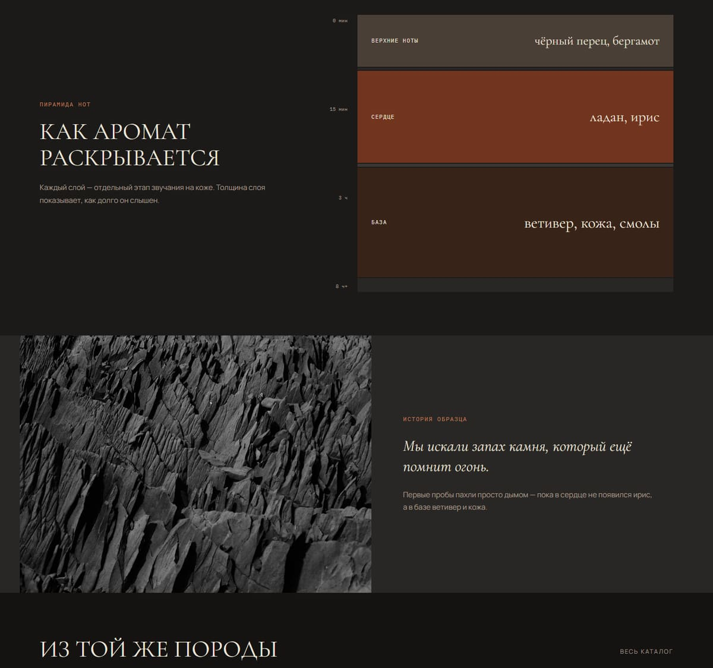
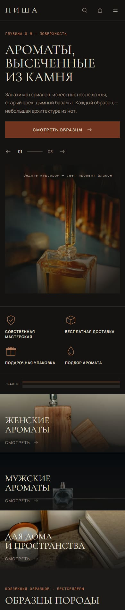

# Ниша — интернет-магазин парфюмерного дома

Полноценный интернет-магазин вымышленного независимого парфюмерного дома: от витрины с анимациями до оформления заказа, личного кабинета и админки. Каждый аромат — «образец породы»: у него есть номер, материал (известняк, травертин, базальт, орех, янтарь), происхождение, плотность и пирамида нот, нарисованная как срез керна.

Проект сделан для портфолио: монорепозиторий на TypeScript, общие Zod-контракты для фронта и бэка, серверный расчёт цен, сессии в БД, e2e-тесты в Chromium и WebKit.



| Каталог | Товар |
|---|---|
|  |  |

| Пирамида нот и история образца | Главная на телефоне |
|---|---|
|  |  |

## Что умеет

**Витрина**
- Каталог с фильтрами (категория, материал, объём, цена, плотность), сортировкой и поиском по нотам, названию и номеру образца; фильтры живут в адресе и переживают «назад» и перезагрузку.
- Товар с вариантами объёма, остатком «осталось 3 флакона», пирамидой нот и «Сообщить о поступлении» для закончившегося образца.
- Избранное, корзина гостя и аккаунта (при входе корзины сливаются), подбор аромата, журнал.

**Заказ**
- Оформление с сохранёнными адресами, доставкой курьером, в пункт выдачи или самовывозом из бутика.
- Мок-оплата: на оплату 5 минут, образцы на это время зарезервированы; не оплатил — заказ отменяется, остаток возвращается.
- Оформление без регистрации: после оплаты приходит письмо со ссылкой, чтобы задать пароль.
- Личный кабинет: история заказов с понятными статусами, «Повторить заказ», адреса, профиль.

**Админка**
- Заказы и смена статусов, товары с вариантами и снимками, справочники, слайды первого экрана, статьи журнала, заявки на консультацию, настройки магазина.

**Движение** (GSAP, всё отключается при «уменьшении движения»)
- Заголовки выезжают строками из-под маски, снимки раскрываются шторкой с параллаксом, карточки — каскадом.
- На десктопе: инерционная прокрутка поверх нативной, шкала глубины у края страницы, закреплённые сцены «Срез» и «Как рождается аромат», полёт флакона в корзину, заставка при первом входе.

## Стек

| Часть | Технологии |
|---|---|
| Web (`apps/web`) | React 19, TypeScript, Vite, React Router 7, TanStack Query, Zustand, CSS Modules, GSAP |
| API (`apps/api`) | Node.js, Fastify 5, PostgreSQL 18, Drizzle ORM, Zod 4, argon2, sharp |
| Контракты (`packages/contracts`) | Zod-схемы и типы, общие для web и api |
| Качество | Vitest, Playwright, ESLint (с проверкой границ слоёв), Stylelint, Prettier, GitHub Actions |

Почему так:
- **Общие Zod-контракты** — одна схема проверяет форму на клиенте и запрос на сервере, а типы ответов выводятся из неё же. Расхождение фронта и бэка ловит компилятор.
- **Цены считает только сервер.** Клиент передаёт вариант и количество; итоги корзины и заказа приходят с сервера. Деньги — целые копейки.
- **Fastify + Drizzle** — быстрый типизированный бэкенд без тяжёлого ORM; транзакции с `SELECT … FOR UPDATE` защищают остатки от гонок при одновременных заказах.
- **Упрощённый FSD** на фронте (`app → pages → widgets → features → entities → shared`), направление импортов проверяет ESLint.

## Архитектура

```
apps/
  web/          витрина и админка (SPA)
    src/app       маршруты, раскладка, провайдеры
    src/pages     страницы
    src/widgets   крупные блоки: карточка товара, шапка, пирамида нот
    src/features  действия пользователя: корзина, фильтры, оформление
    src/entities  данные и запросы: товар, корзина, пользователь
    src/shared    UI-кит, утилиты, анимации, токены дизайна
  api/          REST API
    src/modules   по доменам: catalog, cart, orders, payments, auth, admin…
    src/database  схема, миграции, сид
packages/
  contracts/    Zod-схемы и типы
assets/photos/  исходники снимков (Unsplash) — их нарезает сид
docs/           правила проекта, решения, дорожная карта, макеты, контент-бриф
```

Документы, с которыми удобно начинать:
- [`docs/CONVENTIONS.md`](docs/CONVENTIONS.md) — правила проекта: стек, дизайн-токены, требования к вёрстке и доступности, безопасность.
- [`docs/DECISIONS.md`](docs/DECISIONS.md) — журнал решений: что выбрали, почему и чем за это платим.
- [`docs/ROADMAP.md`](docs/ROADMAP.md) — этапы работы: что сделано, что отложено, известные проблемы.
- [`docs/CONTENT.md`](docs/CONTENT.md) — голос бренда и ассортимент.
- [`docs/design/`](docs/design/) — HTML-макеты, по которым сверстана витрина.

## Безопасность

- Сессии в таблице БД, cookie `httpOnly` + `SameSite=Lax` (+ `Secure` в production), новая сессия при входе.
- Пароли — argon2id. Rate limit на вход и регистрацию. CSRF-защита изменяющих запросов.
- Роли `user` / `admin`; права проверяет сервер на каждом защищённом маршруте (тест перебирает все маршруты админки).
- Helmet-заголовки, CORS только для своего origin, секреты — только в `.env`.

## Запуск локально

Нужны Node.js 26, pnpm 11 и Docker (для PostgreSQL) — или своя PostgreSQL 18.

```bash
pnpm install
cp .env.example .env             # при желании поменяйте пароли
docker compose up -d             # PostgreSQL
pnpm db:migrate
pnpm db:seed                     # каталог, контент, снимки и администратор из .env
pnpm dev                         # web: http://localhost:5173, api: http://localhost:3000
```

Админка — `/admin`, вход с `ADMIN_EMAIL` и `ADMIN_PASSWORD` из `.env`. Оплата ненастоящая: на странице оплаты есть кнопки «Оплатить» и «Отказ банка».

Первый `pnpm db:seed` занимает около минуты: он нарезает снимки в три размера (JPEG и WebP). Повторный запуск уже нарезанное не трогает. Чтобы пересоздать базу с нуля, есть `pnpm db:reset -- --yes` — он удаляет все данные рабочей базы.

### Проверки

```bash
pnpm lint          # ESLint + Stylelint
pnpm typecheck
pnpm test          # Vitest: юнит-тесты и тесты с настоящей PostgreSQL
pnpm test:e2e      # Playwright: Chromium, WebKit и телефон 360 px на отдельной базе *_e2e
```

e2e сами пересоздают свою базу и поднимают api на порту 3100, поэтому не мешают открытому `pnpm dev`.

## Поддержка браузеров и доступность

- Safari 14.1+ / iOS 14.5+: сборка под `safari14`, без возможностей, которых там нет (`:has()`, container queries, `dvh`…), проверка бандла ES-Check.
- Mobile-first, брейкпоинты 360 / 768 / 1024 / 1440.
- axe — 0 нарушений на ключевых страницах, контраст ≥ 4.5:1, зоны нажатия ≥ 44 px, видимый фокус, у каждого снимка осмысленный `alt`.
- Типографика русского текста: неразрывные пробелы после предлогов и перед тире — вручную в статике и утилитой для текстов из БД.

## Ограничения

- Проект не опубликован: это портфолио, деплой не настроен.
- Одностраничное приложение без серверного рендеринга — для настоящего магазина SEO потребовало бы SSR или пререндера.
- Оплата и почта — заглушки (мок-провайдер, письма пишутся в лог).

## Снимки

Все фотографии — с [Unsplash](https://unsplash.com) по [Unsplash License](https://unsplash.com/license). Авторы и ссылки — в [`assets/photos/CREDITS.md`](assets/photos/CREDITS.md). Бренд «Ниша», товары и тексты вымышлены.
